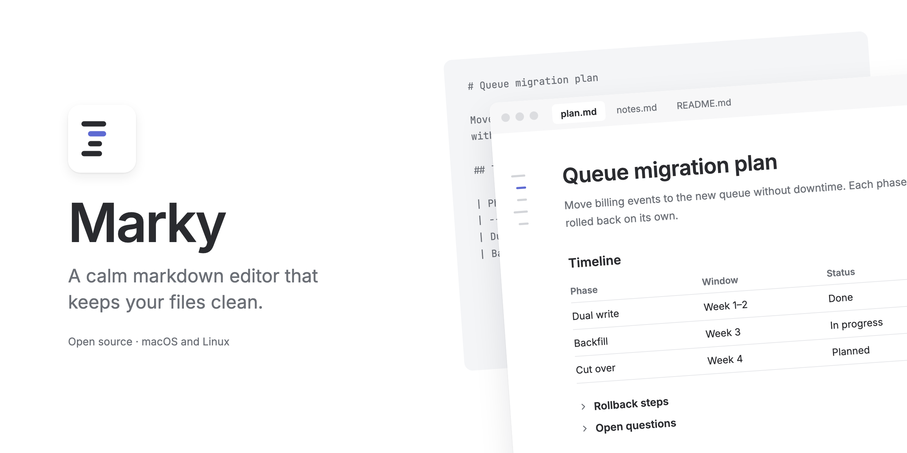

<picture>
  <source media="(prefers-color-scheme: dark)" srcset="docs/images/banner-dark.png">
  
</picture>

# Marky

Marky is a desktop markdown editor for macOS and Linux. It shows your file as a finished document: real tables, diagrams and collapsible sections, with no markdown syntax in the way. When you save, Marky writes only the lines that you edited. The rest of the file stays exactly as it was, so your git diffs stay clean.

Open a file, edit it, close it. There are no folders, no vaults and no setup.

<picture>
  <source media="(prefers-color-scheme: dark)" srcset="docs/images/document-dark.png">
  
</picture>

## Features

- **Clean saves.** Marky keeps the original text of each block that you did not edit. An edit in one table cell changes one line. A file that you open and save without edits does not change.
- **Real tables.** GFM tables show as grids with a header row, not as pipes and dashes.
- **Mermaid diagrams.** A ` ```mermaid ` block shows as a diagram. Click it to edit its source. Marky loads Mermaid only when a file has a diagram.
- **Collapsible sections.** Marky reads `<details>` and `+++` blocks and writes `<details>`.
- **Code blocks** with Shiki highlighting for about 55 languages, a language label and a copy button.
- **Front matter** shows as a properties panel above the document. You can edit the fields.
- **Markdown shortcuts while you type.** `# ` makes a heading, `- [ ] ` makes a task, and `/` opens a menu to insert a table, a diagram, a collapsible section, a code block or an image.
- **Tabs.** Keep several files open in one window. A dot shows unsaved edits. Marky reopens your tabs at the next start.
- **Changes on disk.** When another app changes an open file, Marky reloads it. If you have unsaved edits, Marky asks which version to keep.
- **Light and dark mode** follow the system setting.
- **Small and fast.** The Flatpak download is about 6 MB.

### Outline

A thin rail at the left edge shows one dash for each heading. Hover over the rail to see all headings and go to one.

### Source view

`Cmd+Shift+M` (macOS) or `Ctrl+Shift+M` (Linux) shows the markdown source of the file. Press it again to go back to the document.


## Keyboard shortcuts

Marky uses `Cmd` on macOS and `Ctrl` on Linux.

| Shortcut | Action |
|---|---|
| `Cmd/Ctrl+O` | Open a file |
| `Cmd/Ctrl+S` | Save |
| `Cmd/Ctrl+T` | New tab |
| `Cmd/Ctrl+W` | Close the tab |
| `Cmd/Ctrl+N` | New window |
| `Cmd/Ctrl+Shift+M` | Show or hide the markdown source |

You can also open a file from the command line (`marky notes.md`) or with "Open With" in your file manager.

## Build from source

Marky is a [Tauri 2](https://tauri.app) app with a Svelte 5 frontend and a [Milkdown](https://milkdown.dev) editor. The tool versions are in `mise.toml` (Node and Rust).

On Linux, install the system libraries of Tauri first:

```sh
sudo apt-get install libwebkit2gtk-4.1-dev libappindicator3-dev librsvg2-dev patchelf
```

Then:

```sh
npm ci
npx tauri dev                    # run the app with live reload
npx tauri build --bundles dmg    # macOS package
npx tauri build --bundles deb    # Linux package
packaging/flatpak/build.sh       # build and install the Flatpak for this user
packaging/flatpak/update-sources.sh  # make the offline Flatpak sources again after a lockfile change
```

## Tests

```sh
npm run typecheck
npm test                         # unit and fidelity tests (Vitest)
(cd src-tauri && cargo test)     # Rust backend
npm run test:visual              # screenshot tests in the Playwright container
npm run test:e2e                 # app tests in a real window (Linux, needs tauri-driver)
tests/e2e/docker.sh              # app tests in a Debian container (Arch has no WebKitWebDriver)
```

The fidelity tests open and save each file in `tests/corpus/` and check that no line changes.

## Documentation

- [Style sheet](docs/style.md): the design rules of the UI

## License

Copyright (C) 2026 iammerlijn

Marky is free software under the [GNU General Public License v3.0](LICENSE). You can use, change and share it. If you share a changed version, you must share its source under the same license.
